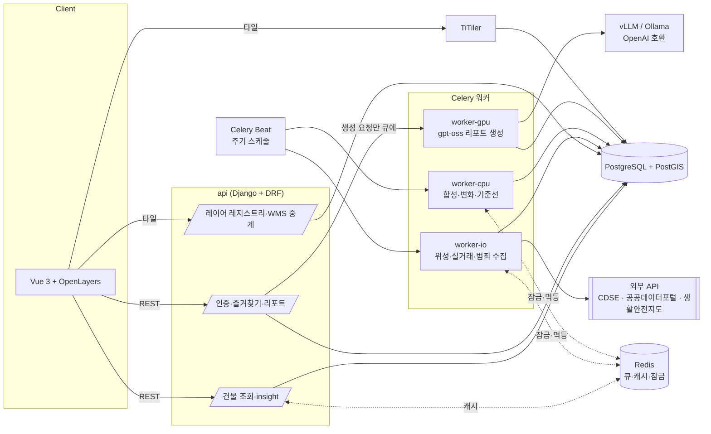
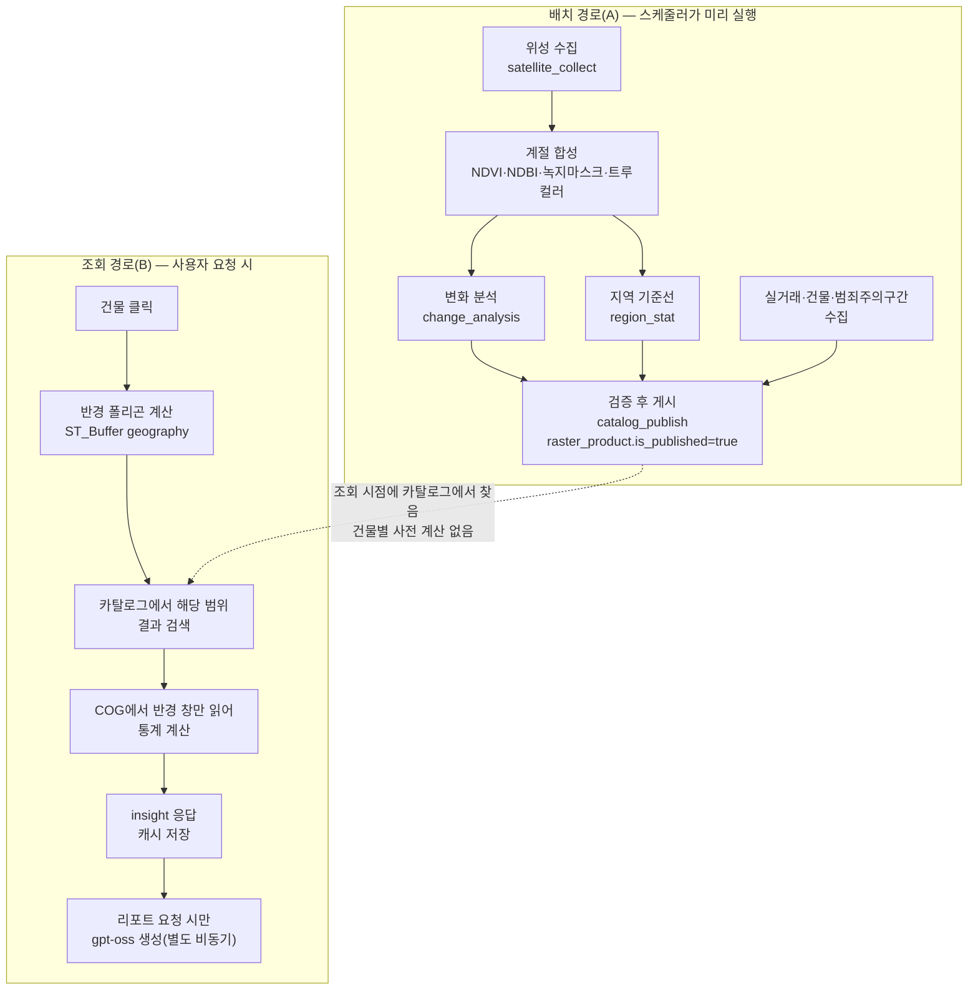

# 지관(地官, JIGWAN)

대전 건물 하나를 클릭하면, 미리 분석해 둔 위성·공공데이터·범죄주의구간 결과에서 그 건물
반경 500m/1km만 잘라 보여주고, 원하면 gpt-oss가 참고용 입지 리포트를 만들어 준다.

## 화면

> 스크린샷·데모 영상 자리 — 프론트엔드 화면이 만들어지면 여기에 넣는다.
>
> - [ ] 지도 + 건물 클릭 + insight 패널 스크린샷
> - [ ] 즐겨찾기 폴더 트리 스크린샷
> - [ ] 리포트 생성 → 폴링 → 결과 화면 스크린샷
> - [ ] 전체 흐름 데모 영상(로그인 → 건물 표시 → 폴더 이동 → 맞춤 리포트) 링크

## 아키텍처



## 데이터 플로우(배치 경로 vs 조회 경로)



## 핵심 설계 판단

- **건물별 사전 계산 대신 결과 카탈로그 + 조회 시 반경 계산**: 위성 분석은 대전 전체를
  대상으로 계절마다 한 번만 돌리고 `raster_product`(결과 카탈로그)에 날짜·bbox와 함께
  쌓는다. 건물을 클릭하면 그 시점에 카탈로그에서 맞는 결과를 찾아 COG의 반경 부분만
  읽어 통계를 낸다. 건물 수(17만 동)만큼 미리 계산해 두지 않아도 되고, 알고리즘을
  바꾸면 카탈로그만 다시 쌓으면 된다.
- **벡터는 EPSG:4326 저장 + `::geography` 계산, 래스터는 EPSG:32652 유지**: 건물·행정경계·
  변화 폴리곤·범죄 구간은 모두 4326 geometry로 저장해 좌표를 그대로 쓰고, 미터 단위
  계산(반경 버퍼, 거리, 길이, 면적)만 `::geography`로 캐스팅해 구면 보정을 받는다.
  위성 COG는 반사율 보존을 위해 재투영하지 않고 32652를 유지하며, 대신 반경 폴리곤을
  그때그때 32652로 바꿔 마스킹한다. "4326에 바로 `ST_Buffer(geom, 500)`"처럼 도(度) 단위를
  미터로 착각하는 실수를 구조적으로 막는다.
- **리포트 검증기**: gpt-oss는 반경 계산 결과 JSON만 입력으로 받고, 출력은 JSON 스키마로
  고정한다. 저장 전에 (1) 스키마 검사 (2) `evidence`의 모든 키가 입력에 실제로 있고
  null이 아닌지 (3) 본문의 모든 숫자가 입력값과 일치하는지(반올림 허용) (4) 금지어(매수
  추천·위험 등)가 없는지를 기계로 검사한다. 실패하면 사유를 붙여 최대 2회 재생성하고,
  그래도 실패하면 `failed`로 저장하고 사용자 한도에서 차감하지 않는다. LLM이 수치를
  지어내거나 투자 권유를 하는 출력이 저장되는 걸 막는 마지막 방어선이다.

## 실행 방법

```bash
cp .env.example .env   # 값 채우기(특히 JWT_SIGNING_KEY, DATA_GO_KR_API_KEY, SAFEMAP_API_KEY)
docker compose up -d db redis
docker compose run --rm api python manage.py migrate
docker compose up -d
```

### 리포트 LLM(로컬 Ollama, 기본값)

GPU 서버 없이 무료로 쓰려고 기본은 로컬 Ollama를 쓴다(vLLM은 NVIDIA GPU가 있을 때만 쓰는
선택지 — [실행 방법](#실행-방법) 위 docker-compose 주석 참고).

```bash
# 호스트(Docker 바깥)에서 Ollama 설치 후:
ollama pull gpt-oss:20b   # :cloud가 붙은 모델(gpt-oss:20b-cloud 등)은 쓰지 말 것 — 로컬이 아니라 Ollama 클라우드로 요청이 나간다
```

`.env`는 `.env.example`의 기본값(`LLM_BASE_URL=http://host.docker.internal:11434/v1`,
`LLM_MODEL=gpt-oss:20b`)을 그대로 쓰면 된다. 로컬 실행은 느릴 수 있어 `LLM_TIMEOUT_SECONDS`
(기본 480초, 실측 CPU 기준 max_tokens=4000 생성에 약 5분)로 제한 시간을 늘릴 수 있다.

### 기반 데이터 적재(1회)

원본 파일은 `data/raw/`에 받아 둔다(git 제외). 국가공간정보포털 `AL_D001_00`(전국 행정경계)은
바깥 zip 안에 레벨별 zip(SIG=시군구, EMD=법정동)이 중첩돼 있는데, `load_regions`가 그 구조를
그대로 읽는다(안쪽까지 따로 풀 필요 없음). `--source-srid`는 생략하면 `.prj`에서 자동으로
읽는다. `sigungu` → `bjd` 순으로 먼저 실행하고, `sido`는 파일 없이 마지막에 실행한다(이미
적재된 시군구를 union해서 만든다 — 시도 경계 원본 파일이 따로 없어도 된다).

```bash
docker compose exec api python manage.py load_regions data/raw/AL_D001_00_20261009.zip --level sigungu
docker compose exec api python manage.py load_regions data/raw/AL_D001_00_20261009.zip --level bjd
docker compose exec api python manage.py load_regions --level sido   # path 없이, sigungu를 union
docker compose exec api python manage.py load_buildings   # data/raw/AL_D010_30_*.zip 중 최신 파일을 자동으로 찾음
docker compose exec api python manage.py seed_map_layers
docker compose exec api python manage.py probe_crime_feature_cap   # .env의 CRIME_FEATURE_CAP·CRIME_DATA_PERIOD 채운 뒤 재시작
```

### 13단계: 초기 적재(백필)

```bash
docker compose exec api python manage.py backfill --dry-run   # 용량 추정만
docker compose exec api python manage.py backfill             # 13개 계절 + 공공데이터
```
계절 단위로 멱등이라 중간에 끊겨도 같은 명령을 다시 실행하면 이미 게시된 계절은 건너뛰고
안 끝난 계절부터 이어서 진행한다. 백필이 끝나면 spec 4장 완료 기준(샘플 건물 20곳에서
insight가 2초 안에 응답)을 다음으로 확인한다.

```bash
docker compose exec api python manage.py measure_insight_latency --count 20
```

### 지역 추가 방법(대전 외 다른 시도)

위 "기반 데이터 적재"·"초기 적재(백필)"는 대전(시도 코드 30) 기준이다. 다른 시도를 추가로
서비스하려면 `areas` 관리 명령을 쓴다 — Git Bash/WSL/맥/리눅스는 `scripts/areas.sh`,
Windows PowerShell은 `scripts/areas.ps1`을 쓴다(둘 다 같은 동작).

```bash
./scripts/areas.sh                            # 대화형 메뉴(지역 목록 → 번호 선택 → 적재 안내)
./scripts/areas.sh list                       # 등록된 지역 + grid/활성화 여부
./scripts/areas.sh status                     # 지역별 단계 진행 상황(경계·건물·실거래·위성·범죄)
./scripts/areas.sh available                  # 추가 가능한 지역(AL_D001_00 zip 기준)
./scripts/areas.sh add 36                     # 세종을 비활성 상태로 등록(실제 수집은 안 함)
./scripts/areas.sh sync --area 36 --dry-run   # 할 일/이미 끝난 일만 확인(아무것도 안 바꿈)
./scripts/areas.sh sync --area 36             # 경계→건물→실거래→위성→범죄 순으로 실행
```

```powershell
.\scripts\areas.ps1
.\scripts\areas.ps1 sync --area 36 --dry-run
.\scripts\areas.ps1 sync --area 36
```

`sync`는 완료 여부를 실제 데이터로 판단한다(이미 끝난 단계는 건너뜀) — 중간에 끊겨도 같은
명령을 다시 실행하면 안 끝난 단계부터 이어서 진행한다(위성은 계절 단위로 이어하기, 실거래는
달 단위로 이어하기). 원본 파일(`AL_D001_00_*`, `AL_D010_{시도}_*`)이 없으면 어디서 받는지
안내만 하고 그 단계를 건너뛴다. 경계·건물 적재가 모두 끝나면 그 지역은 자동으로
활성화(`enabled=True`)된다.

위성 13계절 백필은 오래 걸릴 수 있다(CDSE 다운로드·합성 포함). SSH 연결이 끊겨도 계속
돌도록, 컨테이너 안에서 분리 실행(`docker compose exec -d`)하고 로그는 파일로 남길 수 있다:

```bash
./scripts/areas.sh sync --area 36 --background   # 컨테이너 안에서 분리 실행
./scripts/areas.sh logs 36                        # 진행 상황(로그) 확인, tail -f
```

```powershell
.\scripts\areas.ps1 sync --area 36 --background
.\scripts\areas.ps1 logs 36
```

대화형 메뉴(`./scripts/areas.sh` 인자 없이 실행)에서도 지역을 고른 뒤 "지금 실행"이 아니라
"백그라운드 실행"을 선택하면 위 명령을 그대로 안내해 준다.

### 스케줄 등록(Beat)

```bash
docker compose exec api python manage.py seed_season_schedule     # 계절 종료 15일 후(분기 4번)
docker compose exec api python manage.py seed_collect_schedule    # 위성 수집, 5일마다 02:00
docker compose exec api python manage.py seed_trade_schedule      # 실거래 수집, 매일 04:00
docker compose exec api python manage.py seed_safety_schedule     # 범죄주의구간, 매년 1월 첫째 주
docker compose exec api python manage.py seed_cleanup_schedule    # 보관 기한 정리, 주 1회(월요일)
```

### 데모 모드

```bash
# .env에서 DEMO_MODE=True로 바꾸고, demo/fixtures/demo_snapshots.json의 예시 PNU를
# 실제로 적재된 건물의 PNU로 바꾼 뒤 재시작하면, 그 건물들은 GPU·외부 API 없이도
# insight·리포트가 즉시 채워진다.
docker compose exec api pytest   # 전체 테스트
```

## 데이터 출처·라이선스

| 데이터 | 출처 | 비고 |
| --- | --- | --- |
| 위성 영상 | Copernicus Sentinel-2 L2A (CDSE) | 표시 시 "Contains modified Copernicus Sentinel data [연도]" 표기 필요 |
| 건물·행정경계 | 브이월드 GIS건물통합정보, 브이월드 법정구역정보(AL_D001) | 공공데이터 |
| 실거래가 | 국토교통부 실거래가 공개시스템(공공데이터포털) | API 키 필요, 일 10,000회 한도 |
| 범죄주의구간 | 경찰청 생활안전지도(안전Dream) | WMS, 제공처 고지("등급이 높다고 현재 위험하다는 뜻은 아님")를 레이어에 함께 표시 |
| 배경지도 | OpenStreetMap | "© OpenStreetMap contributors" 표기, 공개 운영 전 자체 타일 서버로 교체 필요(OSM 공식 타일은 대량 사용 제한) |
| LLM | gpt-oss-20b (vLLM 또는 로컬 Ollama, OpenAI 호환 API) | 리포트는 참고 정보이며 투자 자문이 아님 |

이 저장소의 코드는 사이드 프로젝트 학습용으로 작성됐다. 각 데이터 출처의 이용 약관·저작권
표기 의무를 그대로 지켜야 한다.
